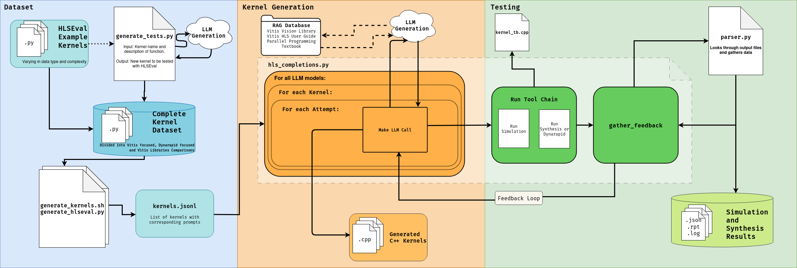

<!--
Copyright (C) 2025, Advanced Micro Devices, Inc.  All rights reserved.

Author: Preston Walker, AMD
SPDX-License-Identifier: MIT
-->

# Reproducing Results
In order to reproduce the results for a specific kernel in your dataset follow these instructions.
### Prerequisites
* Vitis HLS tools
* C++ Compiler
* Python (recommended in venv)
* API Key (whichever LLMs you plan to use, you will need a key for that companies API)
    * This API Key should me made as an Environment Variable called API_KEY. 

>python venv environment
### 1. Generate the tests: 
Run the `generate_tests.py` script from the `dataset` directory. 
  * You can specify which test you want generated by changing the variables `desired_test` and `desired_test_description` at the top of the file.
  * The output should be the `canonical_scalar.cc` and `generate.py` files in the directory `generated_tests/<desired_test>`
### 2. Add the Test Kernels: 
Copy which generated tests that you want to analyze into the `kernels` folder. This is where the kernels will be generated.
### 3. Create the kernels: 
Run the `generate_kernels.sh` script.
  - The output should be `kernel.json` in the `kernels` folder.
### 4. Generate the HLSEval: 
Run the script `generate_hlseval.py`.
  - The output should be `hlseval.jsonl`and `kernel_list.txt` inside the `dataset` directory.
### 5. Generating completions: 
Run the `hls_completions_loop.py` in the `hlseval` main directory.
  - It is required to add some argmuments on the command line. Based on which API key you are using, there may be a different poll request URL.
    - Currently we only support two the public polling url and the AMD azure url. To specify either put byu for public or amd for AMD's workflow. 
  - There are other flags that can be added on the command line that add specific actions of the script. 
    * **Mode** The `--mode` flag gives you an option between `optimization`(default) and `correction` mode. Correction mode will only loop back if the first attempt does not compile in vitis tools. 
    * **Goals:** The `--goals` flag is used to specify which goals you would like to achieve with optimization mode. Simply write strings in double quotes stating what you would optimize. i.e. `"Reduce latency" "minimize warnings"`
  - Example: ```python hls_completions_loop.py amd --mode optimization --goals "Reduce BRAM Usage"```
  - Don't forget to activate Vitis e.g. `source tools/Xilinx/Vitis/2024.2/settings64.sh`
  - The output will be in a `solutions` folder in the `results` directory.
### 6. Analyze results: 
Look at the results from the scripts.
  - The directory which holds all the results is in the `results/solutions` directory. There are subfolders for each model and each model has different attempts. Each attempt number contains the kernels results with a file called `<kernel_name>_data.json`. This file contains the errors, warnings, performance data, and testbench results. Each attempt will show if the model used the feedback and followed the guidelines you provided it. 
### 7. Makefile Completions: 
There is a make file rule for replacing the individual steps 3-6.
  - `make` from within the `hlseval` directory will run steps 3-6.
  - `make clean` will clean the unnecessary files for analysis.

  